# Xem toàn bộ thiết kế — v1

**30 bảng hình hiện hành**, gồm17 bảng nhân vật cho41 hồ sơ,1 bảng góc quay/biểu cảm Trưng Trắc,5 bảng cho14 bối cảnh,4 bảng đạo cụ/phương tiện,1 bảng quân đội,1 bảng động vật và1 bảng24 mặt tộc trưởng tập thể. Bấm hình nhỏ để mở bản gốc.

[Hướng dẫn nhanh](00_READ_FIRST.md) · [Danh mục41 người](CHARACTER_INDEX.md) · [Hướng dẫn agent](AGENT_HANDOFF.md) · [Báo cáo kiểm tra](QA_DESIGN_REPORT.md)

Đây là bộ concept dùng thống nhất cho bản nháp. Các bảng nhiều cảnh/người không dùng trực tiếp làm trang ruột. Chuẩn mới của phương tiện là **PROP03 v002 và PROP04 v002**; các bản v001 tương ứng chỉ giữ đối chiếu.

## CHAR01 — Trưng Trắc — tang bào và giáp chiến

NV01 Trưng Trắc

Trái tang bào; phải giáp Hát Môn. Ảnh gốc 1122×1402 px.

[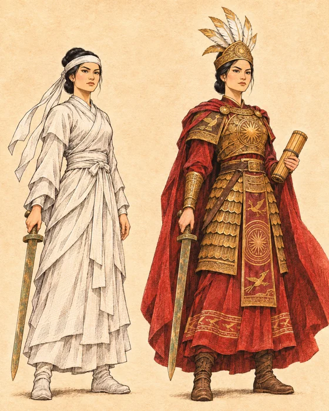](../assets_generated/characters/CHAR_01_Trung_Trac_v001.png)

## CHAR02 — Trưng Nhị

NV02 Trưng Nhị

Trái: đứng; phải: thủ kiếm; giữa: mặt. Ảnh gốc 1122×1402 px.

[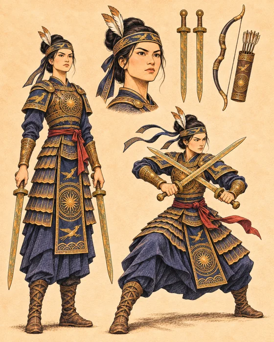](../assets_generated/design_system/CHAR02_v001.png)

[Prompt và ghi chú](prompts/CHAR02.md).

## CHAR03 — Thi Sách

NV03 Thi Sách

Trái: đứng; phải: hắc mã; giữa: mặt. Ảnh gốc 1536×1024 px.

[Prompt và ghi chú](prompts/CHAR03.md).

## CHAR04 — Thánh Thiên

NV04 Thánh Thiên

Trái: đứng; phải: chỉ huy; giữa: mặt. Ảnh gốc 1122×1402 px.

[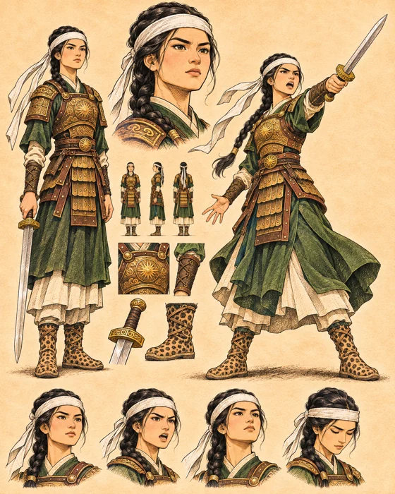](../assets_generated/design_system/CHAR04_v001.png)

[Prompt và ghi chú](prompts/CHAR04.md).

## CHAR05 — Đinh Lương — Phùng Thị Chính

NV05 Đinh Lương; NV06 Phùng Thị Chính

Trái: NV05; phải: NV06; mặt phía trên cùng cột. Ảnh gốc 1536×1024 px.

[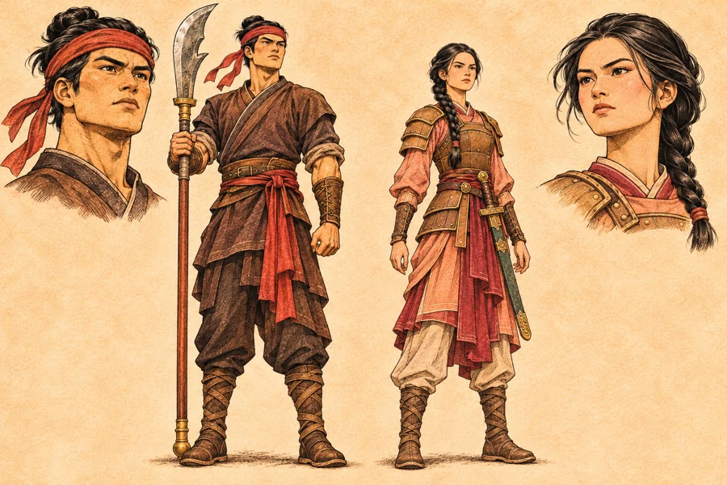](../assets_generated/design_system/CHAR05_v001.png)

[Prompt và ghi chú](prompts/CHAR05.md).

## CHAR06 — Nguyễn Huyền — Trưng Định

NV07 Nguyễn Huyền; NV08 Trưng Định

Trái: NV07; phải: NV08. Ảnh gốc 1536×1024 px.

[Prompt và ghi chú](prompts/CHAR06.md).

## CHAR07 — Đô Năng Tế — Cẩm Nương

NV09 Đô Năng Tế; NV10 Cẩm Nương

Trái: NV09 nam có râu; phải: NV10 nữ. Ảnh gốc 1536×1024 px.

[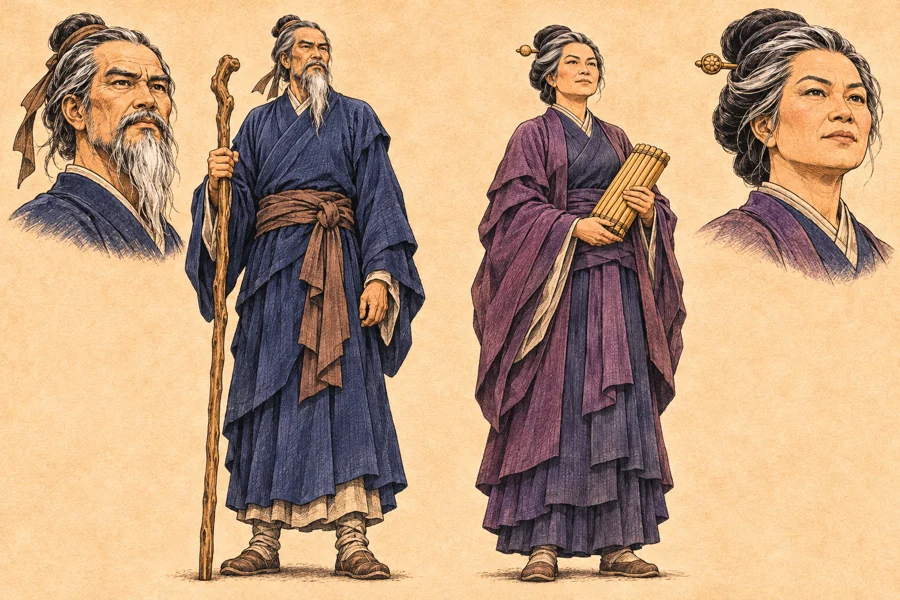](../assets_generated/design_system/CHAR07_v001.png)

[Prompt và ghi chú](prompts/CHAR07.md).

## CHAR08 — Tam vị huyện lệnh

NV11 Lê Đạo; NV12 Đào Chiêu Hiển; NV13 Phạm Danh Hương

Trái NV11; giữa NV12; phải NV13. Ảnh gốc 1536×1024 px.

[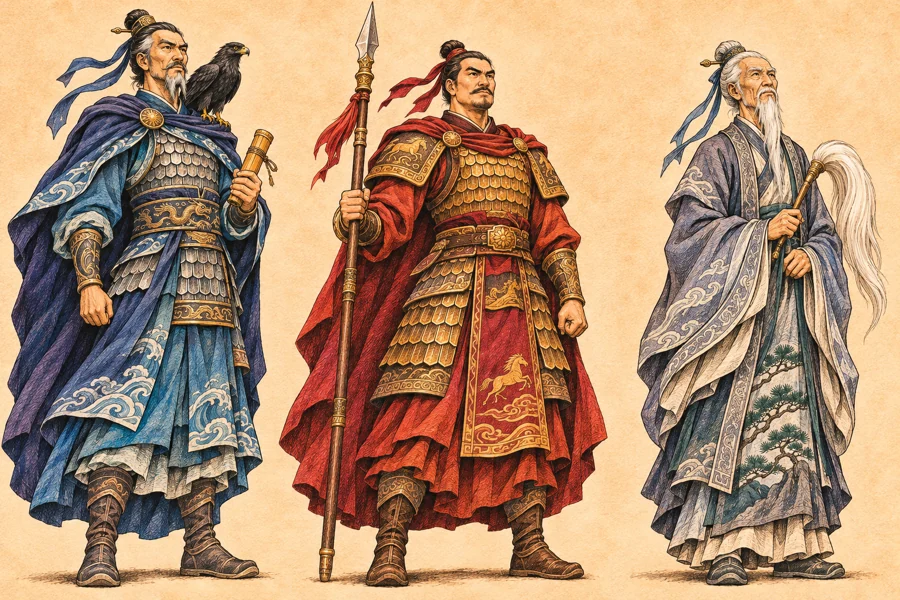](../assets_generated/design_system/CHAR08_v001.png)

[Prompt và ghi chú](prompts/CHAR08.md).

## CHAR09 — Thánh Đóng — Tản Viên

NV14 Phùng Lực Công / Thánh Đóng; NV15 Tản Viên Sơn Thánh

Trái NV14; phải NV15. Ảnh gốc 1536×1024 px.

[Prompt và ghi chú](prompts/CHAR09.md).

## CHAR10 — Tô Định — Tào Quyền — Lữ Thạch

NV16 Tô Định; NV17 Tào Quyền; NV18 Lữ Thạch

Trái NV16; giữa NV17; phải NV18. Ảnh gốc 1536×1024 px.

[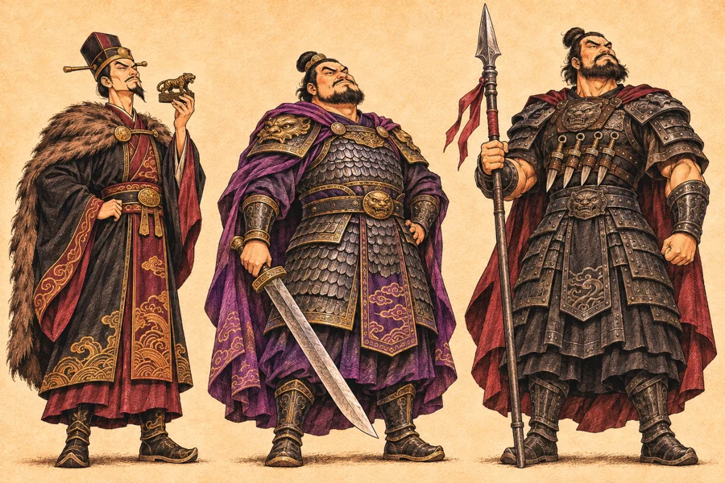](../assets_generated/design_system/CHAR10_v001.png)

[Prompt và ghi chú](prompts/CHAR10.md).

## CHAR11 — Mã Tắc — Lục Hiến

NV19 Mã Tắc; NV20 Lục Hiến

Trái NV19; phải NV20. Ảnh gốc 1536×1024 px.

[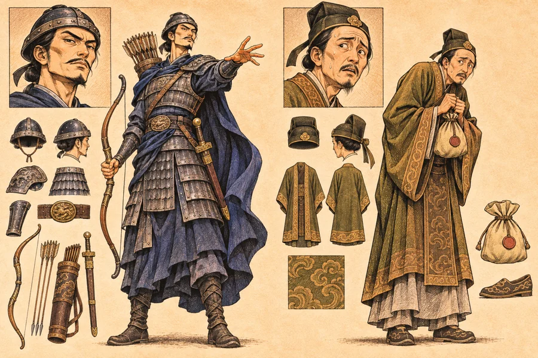](../assets_generated/design_system/CHAR11_v001.png)

[Prompt và ghi chú](prompts/CHAR11.md).

## CHAR12 — Phùng Đặng — Lưu Thị Tuấn — Hùng Duệ Vương

NV21 Phùng Đặng; NV22 Lưu Thị Tuấn; NV23 Hùng Duệ Vương

Trái NV21; giữa NV22; phải NV23. Ảnh gốc 1536×1024 px.

[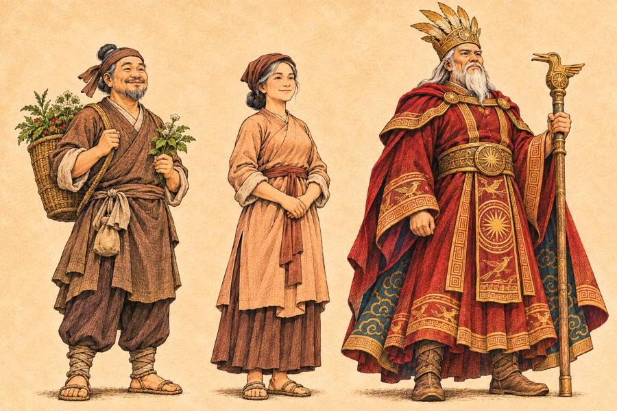](../assets_generated/design_system/CHAR12_v001.png)

[Prompt và ghi chú](prompts/CHAR12.md).

## CHAR13 — Ngọc Hoa — Thục Vương — Hiền Đường

NV24 Ngọc Hoa; NV25 Thục Vương; NV26 Hiền Đường tiên sinh

Trái NV24; giữa NV25; phải NV26. Ảnh gốc 1536×1024 px.

[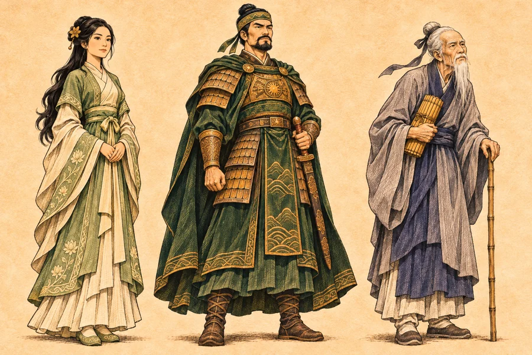](../assets_generated/design_system/CHAR13_v001.png)

[Prompt và ghi chú](prompts/CHAR13.md).

## CHAR14 — Sầm Lân — Sầm Bá — Độc Cô Tấn

NV27 Sầm Lân; NV28 Sầm Bá; NV29 Độc Cô Tấn

Trái NV27; giữa NV28; phải NV29. Ảnh gốc 1536×1024 px.

[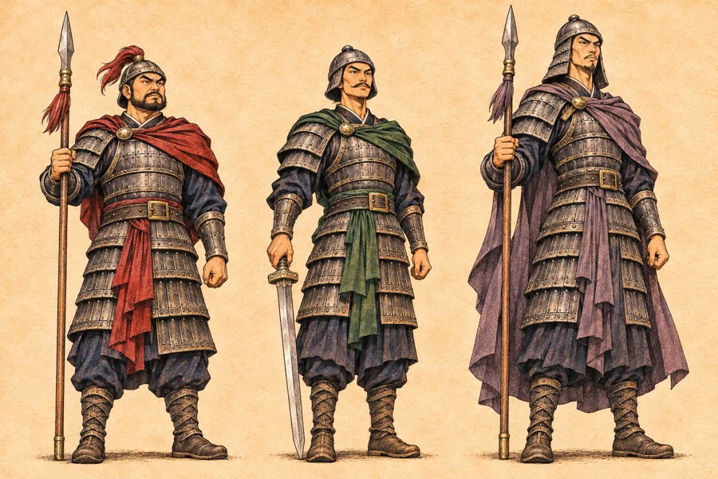](../assets_generated/design_system/CHAR14_v001.png)

[Prompt và ghi chú](prompts/CHAR14.md).

## CHAR15 — Bạch Uy — Lão Bạch — Khúc — Hoàng

NV30 Bạch Uy; NV31 Lão Bạch Kẻ Từ; NV32 Đô tướng họ Khúc; NV33 Đô tướng họ Hoàng

Từ trái NV30,NV31,NV32,NV33. Ảnh gốc 1536×1024 px.

[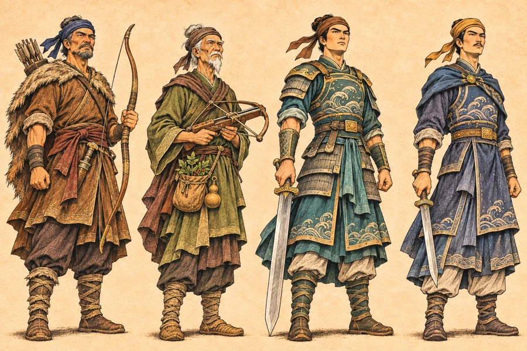](../assets_generated/design_system/CHAR15_v001.png)

[Prompt và ghi chú](prompts/CHAR15.md).

## CHAR16 — Bô lão Chu Diên và anh em họ Đào

NV34 Lão trượng họ Khúc; NV35 Mạc khách họ Kiều; NV36 Đào Đô Thống; NV37 Đào Tam Lang

Từ trái NV34,NV35,NV36,NV37. Ảnh gốc 1536×1024 px.

[Prompt và ghi chú](prompts/CHAR16.md).

## CHAR17 — Lê Chân — Tiên Dung — Chử Đồng Tử — Dương công

NV38 Lê Chân; NV39 Tiên Dung; NV40 Chử Đồng Tử; NV41 Lão Dương công

Từ trái NV38,NV39,NV40,NV41. Ảnh gốc 1536×1024 px.

[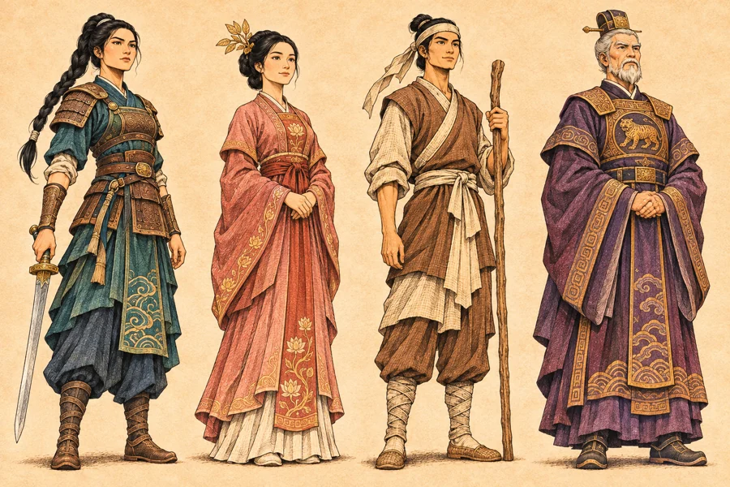](../assets_generated/design_system/CHAR17_v001.png)

[Prompt và ghi chú](prompts/CHAR17.md).

## TURN01 — Trưng Trắc — góc quay và biểu cảm

Hàng trên: trước/nghiêng/sau; dưới: bình tĩnh/buồn/hiệu lệnh/thắng lợi. Ảnh gốc 1536×1024 px.

[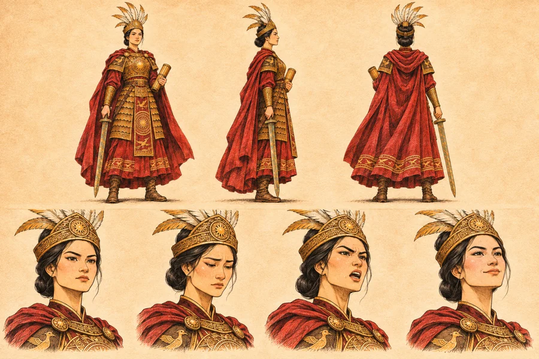](../assets_generated/design_system/TURN01_v001.png)

[Prompt và ghi chú](prompts/TURN01.md).

## ENV01 — Phong Châu / Bạch Hạc / Sân nhà Đông An / Lầu kén rể / Lăng Sương huyền tích

Từ trên xuống: E01,E02,E03. Ảnh gốc 1536×1024 px.

[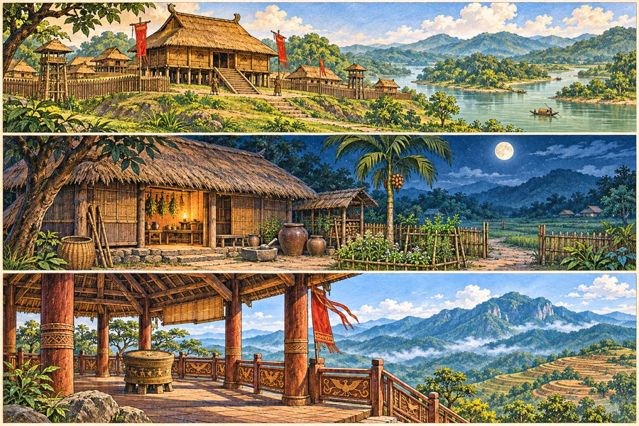](../assets_generated/design_system/ENV01_v001.png)

[Prompt và ghi chú](prompts/ENV01.md).

## ENV02 — Phủ Tô Định / Luy Lâu / Sảnh và sân Chu Diên / Cổng Bắc Luy Lâu / pháp trường

Từ trên xuống: E04,E05,E06. Ảnh gốc 1536×1024 px.

[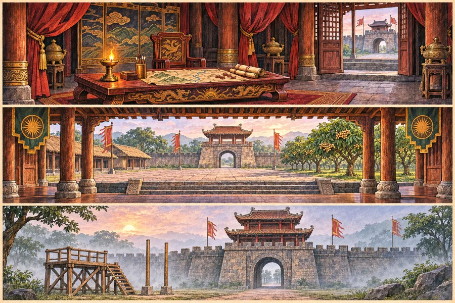](../assets_generated/design_system/ENV02_v001.png)

[Prompt và ghi chú](prompts/ENV02.md).

## ENV03 — Cổ Lôi sơn trang / Đàn thề Hát Môn / Cửa biển Đằng Giang

Từ trên xuống: E07,E08,E09. Ảnh gốc 1536×1024 px.

[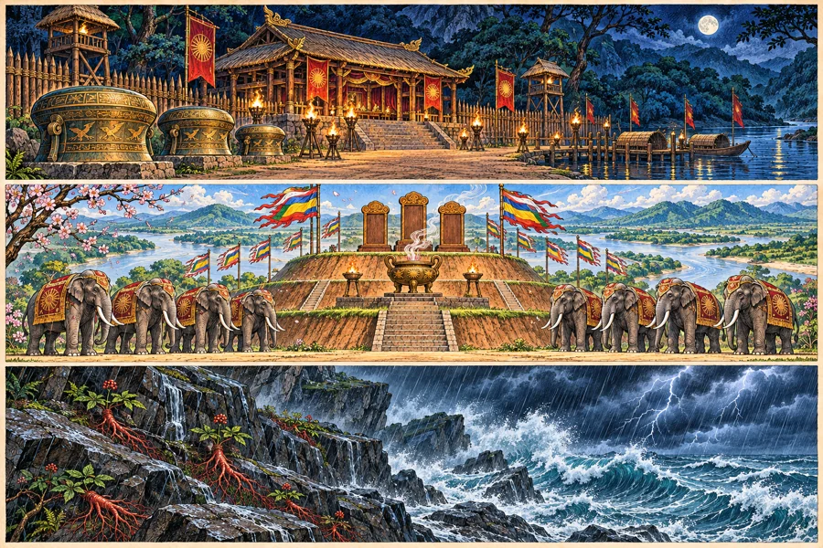](../assets_generated/design_system/ENV03_v001.png)

[Prompt và ghi chú](prompts/ENV03.md).

## ENV04 — Nhà gỗ Nguyễn Huyền / Phượng Hoàng / Khe Mãng Xà / Bến Lục Đầu Giang

Từ trên xuống: E10,E11,E12. Ảnh gốc 1536×1024 px.

[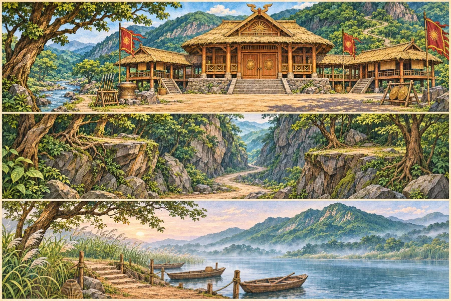](../assets_generated/design_system/ENV04_v001.png)

[Prompt và ghi chú](prompts/ENV04.md).

## PROP01 — Vũ khí chủ lực

4x3 cells, left-to-right row-major; see mapping in catalog. Ảnh gốc 1536×1024 px.

[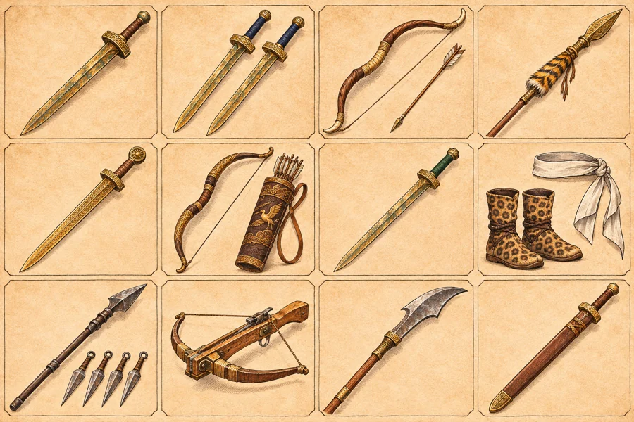](../assets_generated/design_system/PROP01_v001.png)

[Prompt và ghi chú](prompts/PROP01.md).

## PROP02 — Nghi lễ và tín vật

4x3 cells, left-to-right row-major. Ảnh gốc 1536×1024 px.

[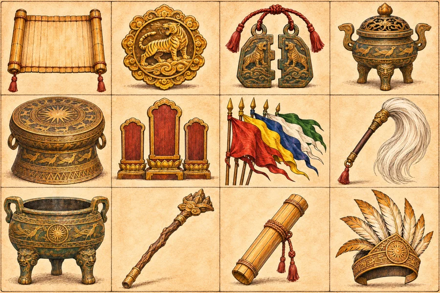](../assets_generated/design_system/PROP02_v001.png)

[Prompt và ghi chú](prompts/PROP02.md).

## PROP03 — Đời sống và chiến thuật

4x3 cells, left-to-right row-major. Ảnh gốc 1536×1024 px.

[Prompt và ghi chú](prompts/PROP03.md).

## PROP04 — Thuyền và phương tiện

2x3 cells, row-major. Ảnh gốc 1536×1024 px.

[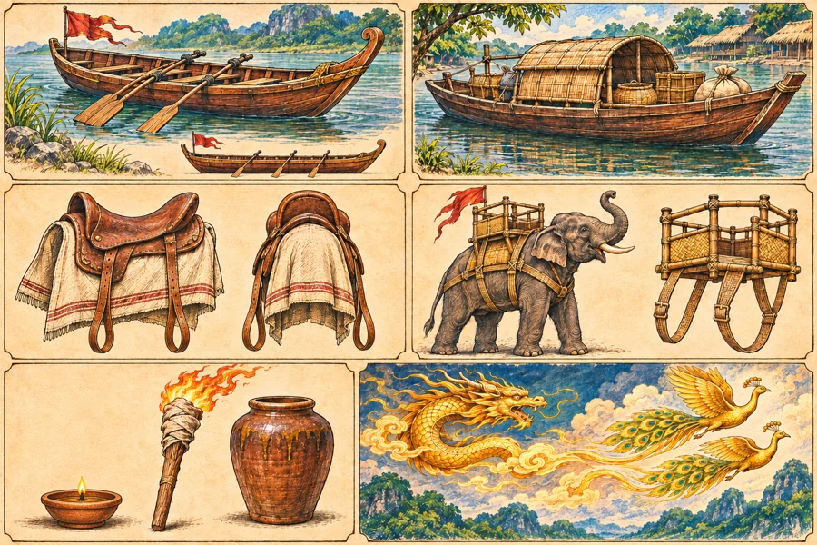](../assets_generated/design_system/PROP04_v002.png)

[Prompt và ghi chú](prompts/PROP04.md).

## ARMY01 — Quân đội và quần chúng

Hàng1: bộ binh/cung thủ/thợ săn/thủy quân; hàng2: kỵ binh/Hán/dân/thân PH03. Ảnh gốc 1536×1024 px.

[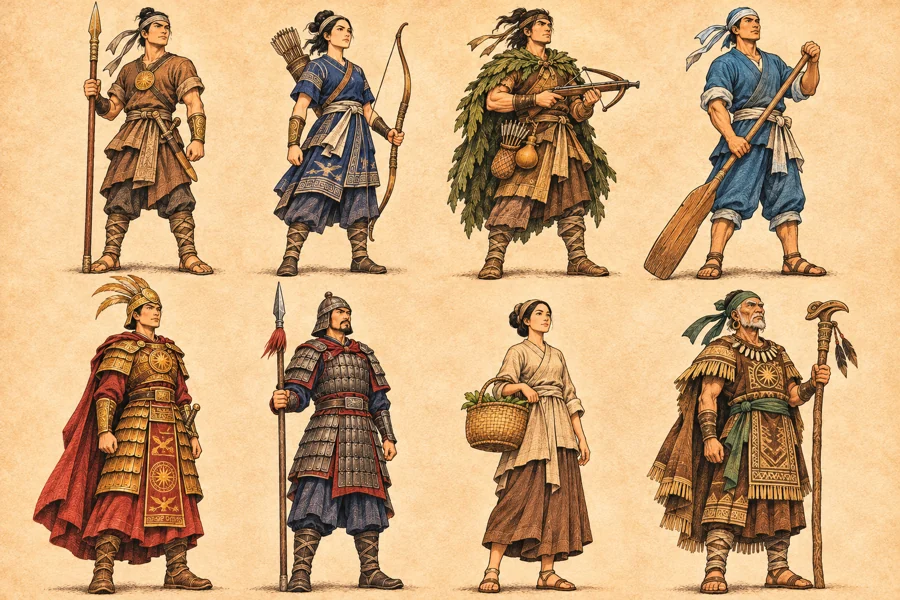](../assets_generated/design_system/ARMY01_v001.png)

[Prompt và ghi chú](prompts/ARMY01.md).

## ANIMAL01 — Hắc mã — chim câu — chim ưng — voi

Trên trái A01; trên phải A02; dưới trái A03; dưới phải A04. Ảnh gốc 1536×1024 px.

[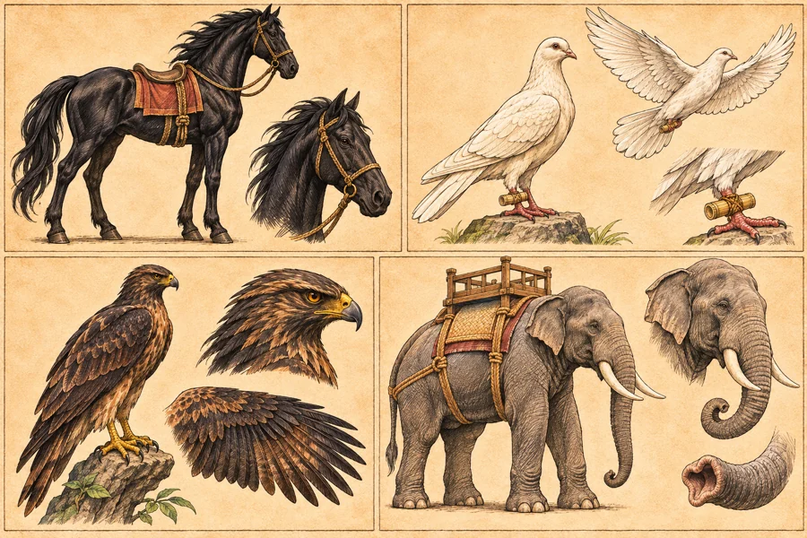](../assets_generated/design_system/ANIMAL01_v001.png)

[Prompt và ghi chú](prompts/ANIMAL01.md).

## CHIEFS01 — 24 tộc trưởng — bộ mặt tập thể

4 hàng x6 cột; ML01..ML17 rồi PH01..PH07; PH03 ô hàng4/cột2 ưu tiên ARMY01. Ảnh gốc 1536×1024 px.

[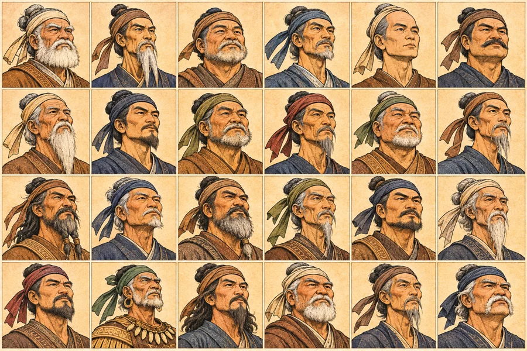](../assets_generated/design_system/CHIEFS01_v001.png)

[Prompt và ghi chú](prompts/CHIEFS01.md).

## ENV05 — Lễ đài Mê Linh và tưởng niệm biểu tượng

Trên E13; dưới E14 (công trình hư cấu cho concept). Ảnh gốc 1536×1024 px.

[Prompt và ghi chú](prompts/ENV05.md).
