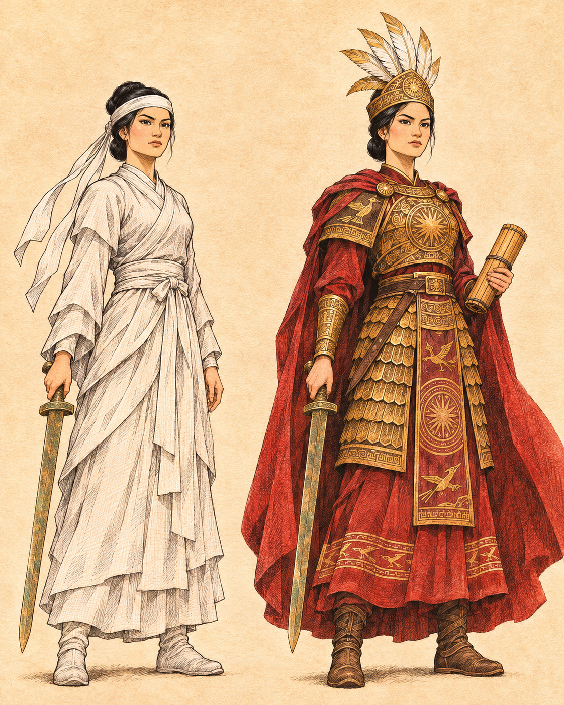
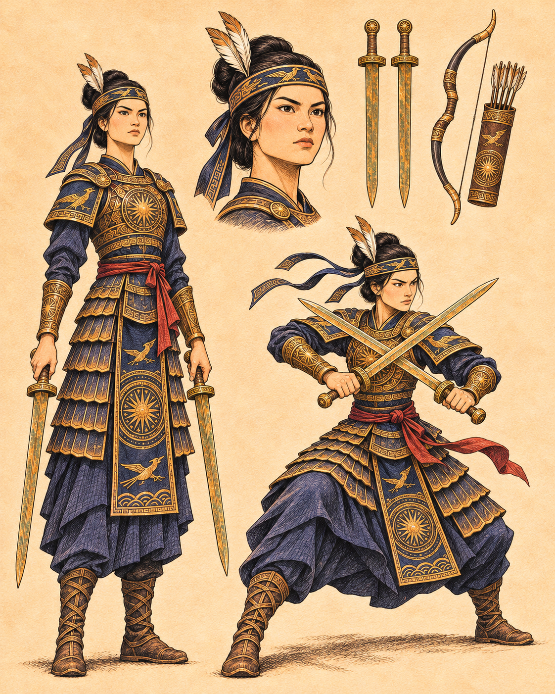
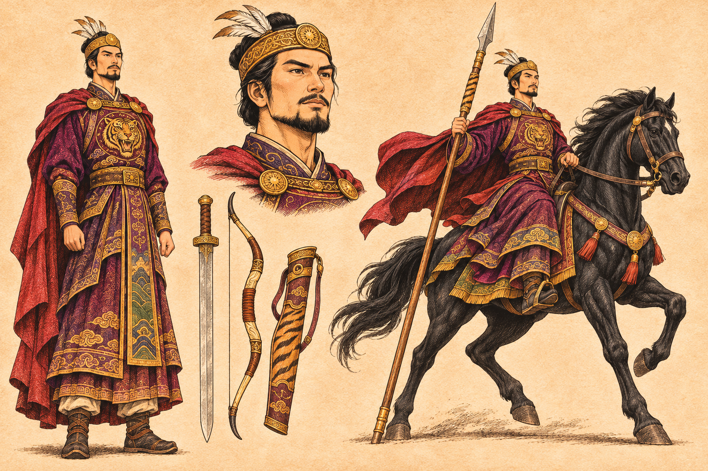
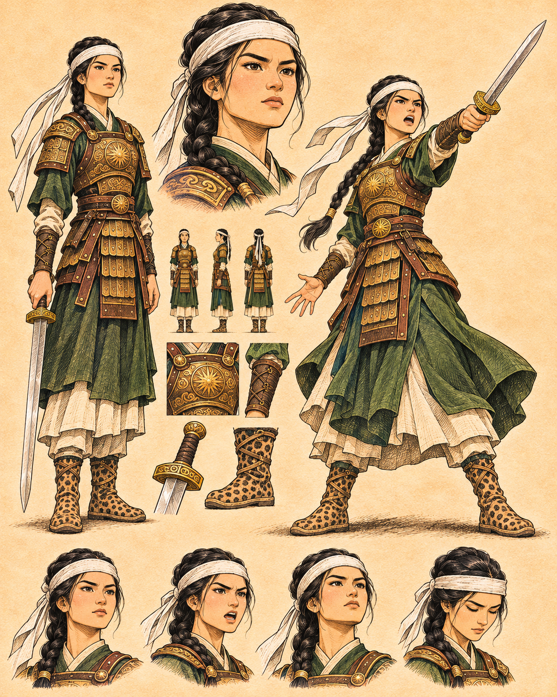
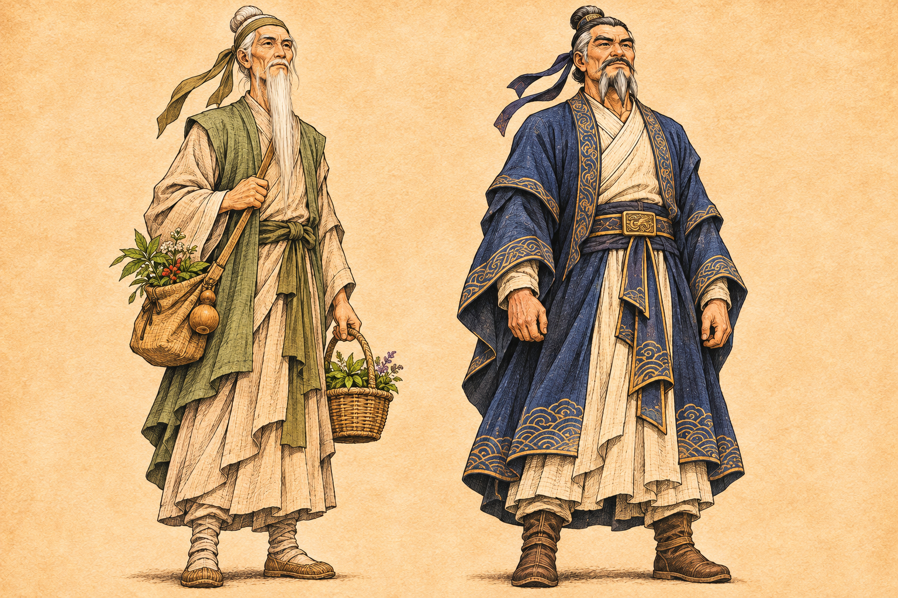
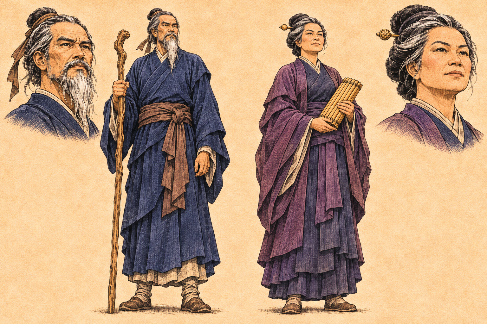
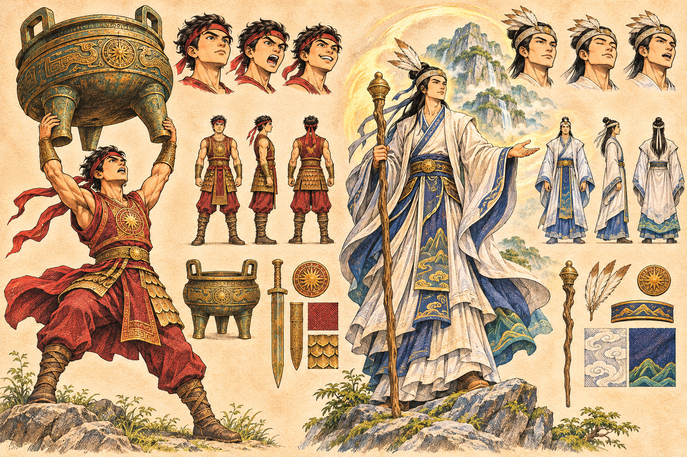

# Xem hình thiết kế — bản v1

**Đã có 9/28 bảng hình** (bao gồm Trưng Trắc v001 từ phiên trước). Danh mục41 nhân vật nằm ở [CHARACTER_INDEX.md](CHARACTER_INDEX.md). Có17 bảng casting; một bảng có thể gồm nhiều người. Còn đang sinh: CHAR10, CHAR11, CHAR12, CHAR13, CHAR14, CHAR15, CHAR16, CHAR17, TURN01, ENV01, ENV02, ENV03, ENV04, PROP01, PROP02, PROP03, PROP04, ARMY01, ANIMAL01.

Tất cả là concept tham chiếu, dùng thống nhất cho bản nháp theo ủy nhiệm; chưa phải toàn bộ ảnh in hoặc xác nhận duyệt từng ảnh. Xem tên/mã và vị trí bên dưới, không đoán tên chỉ từ áo.

## CHAR01 — Trưng Trắc

Trái: tang bào; phải: Hát Môn. NV01.

## CHAR02 — Trưng Nhị

NV02 Trưng Nhị

Vị trí: Trái: đứng; phải: thủ kiếm; giữa: mặt. Kích thước gốc 1122×1402 px. [Prompt](prompts/CHAR02.md).

## CHAR03 — Thi Sách

NV03 Thi Sách

Vị trí: Trái: đứng; phải: hắc mã; giữa: mặt. Kích thước gốc 1536×1024 px. [Prompt](prompts/CHAR03.md).

## CHAR04 — Thánh Thiên

NV04 Thánh Thiên

Vị trí: Trái: đứng; phải: chỉ huy; giữa: mặt. Kích thước gốc 1122×1402 px. [Prompt](prompts/CHAR04.md).

## CHAR05 — Đinh Lương — Phùng Thị Chính

NV05 Đinh Lương, NV06 Phùng Thị Chính

Vị trí: Trái: NV05; phải: NV06; mặt phía trên cùng cột. Kích thước gốc 1536×1024 px. [Prompt](prompts/CHAR05.md).

## CHAR06 — Nguyễn Huyền — Trưng Định

NV07 Nguyễn Huyền, NV08 Trưng Định

Vị trí: Trái: NV07; phải: NV08. Kích thước gốc 1536×1024 px. [Prompt](prompts/CHAR06.md).

## CHAR07 — Đô Năng Tế — Cẩm Nương

NV09 Đô Năng Tế, NV10 Cẩm Nương

Vị trí: Trái: NV09 nam có râu; phải: NV10 nữ. Kích thước gốc 1536×1024 px. [Prompt](prompts/CHAR07.md).

## CHAR08 — Tam vị huyện lệnh

NV11 Lê Đạo, NV12 Đào Chiêu Hiển, NV13 Phạm Danh Hương

Vị trí: Trái NV11; giữa NV12; phải NV13. Kích thước gốc 1536×1024 px. [Prompt](prompts/CHAR08.md).

## CHAR09 — Thánh Đóng — Tản Viên

NV14 Phùng Lực Công / Thánh Đóng, NV15 Tản Viên Sơn Thánh

Vị trí: Trái NV14; phải NV15. Kích thước gốc 1536×1024 px. [Prompt](prompts/CHAR09.md).

